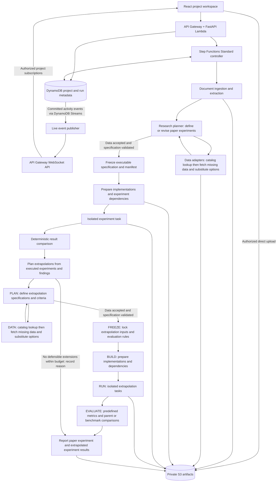

# Paper replication workspace: architecture and implementation plan

Status: proposed ground-up design, updated 2026-10-28. This document changes no application behavior or infrastructure. All application code, infrastructure definitions, tests, and deployment workflows will be implemented anew; no existing repository implementation is reused.

## Product and first release

The application identifies an academic finance paper's main claim and supporting experiment suite, turns them into an inspectable replication plan, reconstructs the experiments using the best defensible available data, compares their outputs with published results where meaningful, and then plans and executes extrapolations before producing the final assessment.

The primary unit is a replication project organized around the paper's main claim and the set of experiments needed to assess it. Tables, figures, and numerical results are evidence within that scope, not the unit users must select to initiate a project. Identify central supporting subclaims where needed. Successful reproduction is evidence of computational reproducibility, not proof of a causal explanation or future profitability.

Live visibility is a first-release requirement. Users see plans, processes, data-search decisions, modifications, implementation artifacts, experiment progress, and incremental results as they become available, rather than waiting for the final report. Interpretation remains read-only. The workspace displays concise process explanations and evidence-linked decision summaries, not private model reasoning or credentials.

First supported methodology: monthly equity portfolio sorts. A versioned specification defines the universe, ranking characteristic, formation/holding windows, exclusions, weights, overlapping cohorts, entry timing, and return/statistical calculations. Unsupported methods produce a feasibility assessment rather than invented implementations.

Data access is an explicit prerequisite. When required data is unavailable, the data adapters seek multiple substitute options and return them to the research planner. The planner owns validation of scientific suitability and reconstructs the experiment as faithfully as possible using defensible options. Exact stock-level replication requires an appropriate historical dataset, potentially supplied by the user. Public preconstructed portfolio returns support only the analyses those returns permit. Changes remain attached to the paper experiment as explicit modifications and caveats, rather than becoming a separate category of adapted-experiment results.

First end-to-end milestone: upload a supported paper, automatically identify its main claim and supporting experiment suite, search and evaluate substitute data where needed, execute supported paper experiments with any modifications disclosed, run a bounded set of extrapolated experiments through the same execution framework, and receive an evidence-backed assessment plus a downloadable research package. The benchmark paper must have a tractable main experiment suite within the supported methods. Internal development may validate individual experiments incrementally, but a single matching table does not fulfill the project milestone. Add broad code generation and more extrapolation methods after this path works.

### Claim and evidence scope

The planner builds a versioned map: main claim -> supporting subclaims -> required experiments -> expected outputs -> references to the original paper. Classify original-paper experiments as central evidence, necessary methodological checks, or supplementary context, with a reason and source references for each classification. Preserve the original requirements alongside executable specifications modified for available data. Freeze each version before execution; experiments cannot be reclassified as optional because their results disagree with the paper.

The workspace determines this scope automatically. In the initial release, users can inspect the extracted claim, scope, references, and assumptions but cannot edit, approve, or override the interpretation. Interpretation does not wait for user confirmation. It must include central counterevidence, explanatory tests, and dependencies needed to assess the wording of the main claim, rather than selecting only favorable headline results. Unsupported central experiments remain visible as coverage gaps; they are not silently removed.

Example: for a claim that intermediate-horizon momentum earns returns unexplained by specified risk mechanisms, the suite includes the relevant portfolio-return experiments and the paper's central tests of those mechanisms. Matching a return table alone reproduces that result, but leaves the explanatory part of the claim unassessed.

Keep three assessments separate: numerical reproduction of each experiment, coverage of evidence relevant to the main claim, and the strength of support for the claim within the tested sample and assumptions. Do not average experiment pass rates into a paper-quality score. Missing central evidence or contradictory findings must qualify the project-level conclusion. Distinguish original-paper experiments from newly proposed robustness or holdout extensions.

### Two result groups

1. **Paper experiment results:** results for the experiments identified in the paper, whether implemented exactly or modified to accommodate available data. Each result carries its execution specification, substitutions, modification history, caveats, and comparison eligibility. Retain multiple executed data-option variants under their paper experiment when relevant; do not hide unfavorable variants or create a third adapted-experiments group.
2. **Extrapolated experiment results:** results from extending an executed paper experiment to new periods, markets, populations, conditions, or declared parameter variations. Link each extrapolation to the specific paper-experiment execution it extends, including inherited modifications and limitations.

Grouping modified results with paper experiments does not make them exact replications. A modification that changes the question being answered must be disclosed; a numerical match under that modification cannot substantiate exact reproduction of the original experiment.

## Architecture

The diagram shows logical stages; each stage does not require a separate service or model. PLAN and XPLAN use the same research-planner component with different experiment purposes; DATA/XDATA, BUILD/XBUILD, and RUN/XRUN likewise reuse their respective components. Data adapters return both exact-source results and substitute candidates to the planner. The planner accepts a defensible option or revises the specification and requests more data. Both loops are bounded. Blocked or exhausted paths preserve reasons and reach assessment rather than looping indefinitely.

Agents perform bounded reasoning tasks. The durable controller owns progression, budgets, retries, cancellation, and failure handling. It fans out independent experiments, respects dependencies, and aggregates all required outcomes, including blocked or failed experiments. Only identifiers and artifact references travel between stages. The final report follows completion or documented termination of the extrapolation stage; an intermediate comparison is not the final report.

### Service boundaries and delivery

One API Gateway routes stable service prefixes to separately deployed Lambda services. HTTP handlers live under `apis/projects`, `apis/research`, `apis/data`, `apis/artifacts`, `apis/activity`, and `apis/identity`. Shared scientific contracts, connector implementations, storage and workflow logic live in `packages/paperlab`; non-HTTP stage execution enters through `workers/replication`. No large shared backend directory is required. Services initially share an internal package and metadata table, while maintaining distinct routers, Lambda configuration, IAM roles and logs.

All new resources follow `jimmy-<env>-<purpose>` naming (account suffixes where global uniqueness is required). Dev and prod use separate GitHub Actions workflows, deployment roles, images, state and application resources. Separate jobs provision secrets and infrastructure, build images and assets, release each API/realtime handler, register worker/runner task revisions, release the research workflow, publish the frontend, configure alerts and verify delivery. Infrastructure is the sole Terraform-state writer; desired configuration is exported to component jobs that own subsequent code/graph releases. A push/merge to `dev` deploys the dev application and publishes the frontend through private S3 and CloudFront; the Actions summary reports its URL. Production deployment is dispatched from `main` through the separate `prod` GitHub environment. Bootstrap identity/state setup is a one-time prerequisite; feature-branch PR checks never deploy.

GitHub environment secrets supply `AWS_ACCOUNT_ID`, `AWS_DEPLOY_ROLE_ARN`, `BIGDATA_SECRET_ARN` (the actual API key despite the retained GitHub name), and `ALERT_EMAIL`; `AWS_REGION` remains an environment variable. Deployment writes the key and email to the matching environment's named AWS Secrets Manager secrets without retrieving values or printing them. Only the resulting key ARN enters Terraform and ECS configuration. The alert email subscription is configured after deployment outside Terraform so the address is not persisted in plans/state. The bootstrap role permits only writes to these two named secrets; the worker execution role retrieves only the API key for ECS injection.

Agents use AWS Bedrock with configurable role routing: Kimi K3 (`us.moonshotai.kimi-k3`) for all roles, including scientific planning, data-suitability decisions, extrapolation planning and worker tasks such as the narrative assessment. Kimi calls use native `InvokeModel` with explicit reasoning effort (`high` planner, `low` worker) and bounded output limits (32,768/8,192 tokens); incomplete replies expose safe stop/usage metadata and never become measured results. Price retrieval uses yfinance; other financial-content discovery starts with Bigdata.com. Its document search output is evidence, not automatically a numerical dataset. Both sit behind a connector registry so additional providers can be onboarded without rewriting the scientific workflow.

### Deployment responsibilities

| Component | Responsibility |
| --- | --- |
| React | Upload, live activity timeline, read-only evolving plans/specifications, data searches and decisions, experiment progress, incremental results, comparison and evidence inspection |
| API Gateway / FastAPI Lambda microservices | Authentication, authorization, upload URLs, project CRUD, immutable run creation, snapshots, cursor-based activity replay and read-only interpretation retrieval |
| API Gateway WebSocket API and event publisher | Authenticate connections and authorize project subscriptions; push committed activity notifications and artifact references; clean up expired connections and support reconnect/replay |
| Step Functions Standard | Durable stage transitions, automated validation checkpoints, bounded retries, task completion, terminal outcomes |
| Document processing task | Parse PDF text/tables with page references; use an OCR fallback when needed; preserve extraction artifacts |
| Research planner | Identify claims, experiments and dependencies; validate interpretation and data suitability using deterministic check tools; evaluate substitute options; reconstruct experiments with versioned modifications/caveats; plan extrapolations and their evaluation criteria |
| Data adapters | Check the internal dataset catalog before internet retrieval; reuse accessible compatible snapshots, retrieve missing data or justified refreshes, seek substitute candidates, and return provenance, constraints and quality checks for planner evaluation |
| Implementation builder | Prefer trusted methodology templates; later support constrained generated implementations |
| Isolated runner | Run numerical code against fixed inputs, producing machine-readable outputs and logs |
| Comparator / evaluator | For paper experiments, apply predefined tolerances and check whether published-value comparisons remain valid after modifications; for extrapolations, compute predefined metrics and parent/benchmark comparisons without inventing published targets |
| Assessment writer | Synthesize paper experiment results with modification caveats and extrapolated experiment results; disclose coverage gaps and contradictions against the main claim; cannot overwrite measured outcomes |
| DynamoDB | Project ownership, claims, experiment-suite/specification metadata, runs, interpretation and data decisions, shared dataset catalog, acquisition leases, immutable artifact references, activity events and connection/subscription metadata |
| S3 | Private project artifacts and immutable shared dataset objects; eligible internet datasets are stored once and referenced by multiple projects/runs rather than copied per user |

Keep the API control plane separate from document processing and numerical workloads. Run experiments in dedicated ephemeral tasks with fixed resource limits. Do not execute generated code inside the API, planner process, or shared queue consumer.

SQS is optional for the initial submission path. The controller can dispatch per-run tasks directly. Add queues where worker capacity or provider throttling requires buffering, with an explicit consumer and completion protocol. Do not run a second orchestration loop in a queue worker.

The research planner and data validator are one component. Data profiling, missing-value checks, timestamp checks, and schema/coverage checks remain deterministic tools. Adapters report measurable properties; the planner decides scientific suitability. No separate data-validator agent or service is required.

## Data catalog and shared dataset storage

The adapter checks what is already in the system before fetching from the internet. A searchable dataset catalog in DynamoDB identifies committed snapshots and their S3 objects. The catalog is shared across users for eligible datasets, while access decisions remain specific to the requesting principal. A shared object is private infrastructure storage, not a public download URL.

### Catalog-first acquisition

1. **Describe the request:** normalize source preference, dataset/variables, entities, date coverage, frequency, units, return/adjustment conventions, required vintage/as-of information, transformation version, access scope and freshness requirements.
2. **Search the catalog:** look for accessible committed snapshots matching the request. Check compatible superset coverage as well as exact matches. Do not treat a similar title, ticker or URL as sufficient identity.
3. **Validate compatibility:** run deterministic metadata/coverage checks and return usable matches or possible substitutes to the planner. An exact cached dataset still needs planner suitability evaluation. Cached substitutes follow the same DATA -> PLAN process as newly discovered options.
4. **Reuse a match:** bind the run's manifest to the immutable dataset version and S3 object references. A subset can be represented by explicit filters/partition references, without copying the full dataset into the project directory. Materialize new derived data only when the transformation requires it.
5. **Coordinate a miss:** acquire a bounded lease for the acquisition key. A concurrent request waits for the in-progress acquisition or reuses its committed output rather than downloading and uploading another copy. Expired leases can be recovered with conditional ownership checks.
6. **Fetch only what is needed:** retrieve missing partitions/ranges where the provider's interface and revision semantics support it. When a fresh snapshot is required or incremental retrieval is unsafe, fetch a complete version and disclose that choice. Search for alternate sources when required data remains unavailable.
7. **Publish atomically at the metadata boundary:** validate downloaded data, calculate content checksums, write immutable objects, then mark a catalog version committed. Other runs must not consume partial downloads or pending catalog entries. Release the lease and emit an availability event.

The catalog lookup is a normal first step, not an optional optimization. Internet discovery can still identify a better-fidelity source when the catalog contains only an imperfect substitute. Retain request-match and selected-source decisions for traceability.

### Deduplication and immutable versions

Use two distinct identities:

- **Acquisition key:** identifies an equivalent retrieval request, including access scope, source and version/vintage semantics; coordinates cache lookup and concurrent acquisition. Equivalent requests do not prove that the source's contents have not changed.
- **Content identity:** a cryptographic checksum of the actual artifact bytes, within an allowed sharing scope. A catalog dataset version references one or more such objects, plus schema and provenance. Multiple retrieval records can point to the same stored bytes without losing source history.

Store eligible shared dataset objects under a layout such as `shared-data/objects/sha256/{content_hash}`. Store project manifests, decisions, results and private inputs under owner/project-scoped keys. Two users who require the same accessible dataset version receive separate run manifests referencing the same shared S3 objects; no permanent per-run source-data copy is created.

Use conditional creation for canonical object keys so concurrent writers cannot overwrite an existing object. Content hashing alone does not deduplicate differently serialized but logically equivalent files; initially deduplicate exact bytes and identical deterministic normalization outputs. Key derived datasets by input snapshot references, transformation code/version, parameters and output schema. Do not merge different sources or vintages merely because they look similar, and do not assume an S3 ETag is the content checksum.

For example, two runs using the same monthly-return snapshot reference one shared dataset version. A third run needing a contained date range can reference the same version with a frozen filter. If the provider revises historical values, a refresh creates a new immutable version; previous runs remain bound to the old version. If a refresh returns identical bytes, retain the new retrieval record while reusing the existing object.

### Sharing, evaluation boundaries and retention

Cross-user sharing applies only when source terms and entitlements permit it. Internet availability alone does not imply permission for platform-wide reuse. User uploads, account-specific credentials/data and restricted datasets remain tenant- or project-scoped unless explicitly authorized for sharing. Search and reuse must enforce those scopes without revealing other users' dataset existence, project names or research activity.

Storage deduplication does not grant access to the whole source object. Stage only the authorized experiment slice for a runner; a cached object containing reserved holdout observations must not expose those observations to planning/training tasks. Public objects are still delivered through authorized application access rather than a publicly readable bucket.

Deleting a project removes its references and private artifacts according to policy; it must not delete shared objects used by other retained projects. Track durable references and use a reconciliation/grace-period garbage-collection process before removing unreferenced data. A simple cache TTL must not remove inputs required to reproduce retained runs. Temporary acquisition files can be cleaned after canonical commit and recovery checks.

The live workspace exposes catalog search, cache hits, pending shared acquisitions, selected dataset versions and new retrievals. It shows source/version provenance but no information about other users consuming those objects.

## Workflow and scientific boundaries

1. Create project and upload paper/supporting files through bounded, owner-scoped upload URLs. Validate upload completion, type, size, and checksum before parsing.
2. Extract content and preserve page/table/equation references. Treat document text as evidence, not executable instructions.
3. Identify the main claim and central supporting subclaims. Map the original experiment suite and dependencies to those claims, with expected outputs, source references, table headers, units, footnotes, and t-statistics. Validate the scope automatically and expose the resulting interpretation read-only rather than requiring selection of an isolated table.
4. Assess feasibility and ambiguities automatically. Apply documented, versioned interpretation policies only when justified; record inferred assumptions separately from explicit paper instructions. If a material ambiguity prevents a defensible implementation, mark the affected experiment as blocked or inconclusive with the competing interpretations, and continue independent experiments. Do not ask users to adjudicate the interpretation. Missing data/access may be supplied separately without permitting changes to scientific scope.
5. Resolve data requirements through catalog-first adapters. Reuse accessible compatible dataset versions before fetching missing data or required refreshes from the internet. If inputs remain missing or unsuitable, seek multiple substitute options, return them to PLAN, and reconstruct the experiment using defensible available inputs. The planner evaluates scientific suitability using deterministic check outputs, records modifications/caveats, and repeats within a fixed search/replanning budget. Store raw data separately from normalized data; share eligible immutable objects through references rather than per-user copies. Block the affected experiment only when no defensible reconstruction is available within the budget; continue independent experiments.
6. Finalize and freeze the claim/evidence map, suite specification, individual experiment specifications, dataset snapshots, comparison tolerances, and any reserved evaluation protocol. Subsequent scientific changes create a new version/run.
7. Prepare implementation from a trusted template and verify timing, weights, compounding, and statistics on small examples. Generated code is a later capability behind the same contract.
8. Execute each experiment with pinned environment, recorded seeds, and immutable inputs, respecting dependencies and sharing immutable inputs where appropriate. Preserve intermediate holdings, predictions, or coefficients needed to investigate discrepancies. Independent experiments can continue if another is blocked; dependent experiments report the unmet dependency.
9. Compare each paper experiment's outputs with published values where compatible. Record modifications and explain when published-value comparison is approximate or invalid. Preserve results under the corresponding paper experiment, including any executed substitute-data variants, before aggregating at the suite level.
10. Invoke EXT using the executed specifications, data limitations, outputs, and comparison findings. Plan a bounded suite of extrapolations linked to parent executions. Run each through PLAN -> DATA -> planner validation/replanning -> FREEZE -> BUILD -> RUN -> EVALUATE, using the same components and recording every attempted variant. Do not require a positive or matching original result before considering extrapolations; do not extrapolate from an execution with unresolved correctness errors.
11. Once extrapolations complete or have documented blocked/failed/budget-exhausted outcomes, generate the final main-claim assessment. Present two result groups: paper experiments (original or modified, with caveats) and extrapolated experiments. Include missing central evidence, contradictions, and limits of interpretation. Failed replication is a valid research outcome, distinct from software failure. Infrastructure retries never alter scientific assumptions.

### Substitute-data search and replanning

For each unmet requirement, adapters return a candidate set where possible. Record candidate source, variables, sample/universe coverage, observation and availability dates, units, data quality, access constraints, and differences from the required data. Report when fewer than multiple defensible options exist rather than fabricating alternatives.

The planner evaluates candidates before inspecting experiment performance. It prefers methodological fidelity and suitability to the claim, not favorable returns or similarity to published values. It can select one option, select several for sensitivity analysis under the same paper experiment, request further retrieval, or conclude that reconstruction is not defensible.

For each selection, persist the original requirement, alternatives considered, selection/rejection rationale, required methodology changes, effect on the question being answered, and comparison limitations. Preserve the original claim/evidence map. Each revised executable specification is immutable once frozen, and still points to the original paper experiment. Subsequent changes create new versions without deleting previous attempts.

### EXT: extrapolation planning and execution

EXT is a required workflow stage that reuses the full experiment pipeline, not a single agent call or an optional direct jump from COMP to REPORT.

1. **Inspect the parent execution:** read its actual methodology, modifications, data constraints, results and discrepancy findings. Resolve implementation correctness issues before treating outputs as a foundation for extensions.
2. **Propose justified extrapolations:** for example, later periods, other markets, other asset universes, different economic conditions, or bounded parameter/assumption changes. Explain which aspect of the main claim each tests. A parameter change is a sensitivity test, not necessarily evidence about a new population.
3. **Select a bounded suite:** record hypotheses, parent execution IDs, dimensions changed, dimensions held fixed, data requirements, dependencies, evaluation metrics, benchmarks, and stopping rules. Keep the original paper-experiment results unchanged.
4. **Run the common PLAN/data loop:** request inputs and substitute options, evaluate them with the research planner, and revise specifications with explicit caveats where needed. If a required parent experiment produced no usable execution, record the limitation rather than inventing a parent result.
5. **Freeze and execute:** lock each specification and dataset manifest, prepare the implementation, and run in isolation. Holdout evaluation data is unavailable to the planner and training process until the method and evaluation rules are frozen.
6. **Evaluate outcomes:** calculate predefined metrics and uncertainty, compare with parent experiments and relevant baselines, and account for overlapping samples and multiple attempted tests where applicable. Do not use the paper's original numerical result as an expected value for a new setting.
7. **Aggregate for REPORT:** preserve all extension outcomes, inherited caveats, unsuccessful attempts and exclusions. Observed-result-driven extrapolations are exploratory; only appropriately reserved evaluations support holdout claims.

Every project records the extrapolation stage outcome. If no defensible extrapolations can execute within access, methodological, or resource limits, finish with the reason and available evidence; do not wait indefinitely or claim extrapolation succeeded. Recursive extrapolation is disabled initially: one bounded generation of child experiments follows the paper-experiment suite.

Define holdout boundaries before accessing evaluation outcomes. The replication worker should receive only replication inputs; a separate evaluation task receives holdout data after the method is frozen. A historical post-publication sample may already be familiar and is not automatically an untouched holdout. Report the actual independence limits.

Do not gate the report on positive or matching results. Do not let an agent repeatedly change the specification until it matches the paper. Diagnostic changes must remain visible as additional attempts.

## Persistent contracts

These are logical records and artifact contracts, not a requirement for a separate database table per entity. They cover both paper experiments (original or modified, with caveats) and extrapolated experiments. Only application services create scientific interpretation/specification versions; users inspect them read-only.

| Entity | Minimum contents |
| --- | --- |
| Project | ID, owner, title, paper/artifact references, main-claim and suite-version references |
| Paper extraction | Original checksum, parser version, text/tables, page anchors, extraction uncertainties |
| Claim | ID/version, main or supporting role, precise wording, scope/qualifiers, source anchors, evidence links |
| Experiment suite | ID/version, claim links, required/supplementary experiment membership and rationale, dependencies, coverage plan, assessment criteria |
| Target result | Experiment ID, claim/evidence links, table/figure/cell identifiers, published values, units, precision, provenance |
| Experiment specification | ID/version, suite and claim links, paper or extrapolation purpose, original-paper requirements, executable method, selected substitutes, modifications/caveats, data requirements, dates, formulas, rules, statistics, tolerances, evaluation criteria, assumptions, source anchors |
| Interpretation decision record | Research-planner version, timestamp, specification version, extracted or inferred choices, alternatives, source references, deterministic validation findings, rationale, unresolved ambiguities |
| Data requirement | ID/version, experiment/specification links, original required variables, universe, dates, frequency, units, conventions, availability/vintage requirements, source preferences, freshness and access constraints; preserve separately from accepted substitutions |
| Data candidate decision | Unmet requirement, candidate sources and profiles, quality-check artifacts, planner selection/rejection reasons, resulting specification version, comparison limitations, search/replanning budget consumed |
| Dataset catalog version | Dataset/version ID, acquisition key, source and retrieval provenance, committed/pending status, coverage, variables, conventions, vintage/freshness, schema, transformations, access/sharing scope, immutable object references and checksums |
| Dataset acquisition record | Request/requirement and scoped acquisition key, catalog lookup and compatibility findings, cache-hit/miss/refresh outcome, reused version or retrieval source/time, request parameters without credentials, resulting version/object references, status and error details; identical-byte refreshes preserve retrieval history without storing another object |
| Acquisition lease | Scoped acquisition key, owner/fencing token, expiry, progress and pending/committed output reference; conditional updates prevent stale owners publishing over newer acquisitions |
| Artifact object | Immutable artifact ID, checksum/algorithm, S3 location/version where applicable, size/format, artifact kind, commit status, sharing/access scope and provenance; multiple compatible dataset versions may reference one object |
| Retained artifact reference | Project/run or dataset-version owner, immutable object/version reference, purpose and retention eligibility; supports reference-aware deletion without removing data still required by another retained run |
| Dataset manifest | Catalog version and immutable object references, source/retrieval provenance, checksums, exact slices/filters, schema, observation and availability dates, transformations, exclusions, limitations, quality-check artifacts, planner suitability decision |
| Implementation bundle | Code hash, template/generator version, dependency lock or image digest, verification evidence |
| Suite run | Owner/project, frozen suite version, child experiment-run references, aggregate execution status, coverage and assessment references |
| Experiment run | Suite-run and experiment IDs, result group (`paper_experiment` or `extrapolated_experiment`), original or modified execution mode, specification and data hashes, implementation hash, parent execution, timestamps, status, limits, output references |
| Extrapolation plan | Parent executions, proposed/selected/excluded extensions with reasons, changed/fixed dimensions, exploratory or reserved-evaluation designation, metrics, baselines, dependencies, budgets, stage outcome |
| Step attempt | Run/stage/attempt IDs, idempotency key, inputs/outputs, model/version and prompt references where applicable, usage, failure category |
| Activity event | Stable event ID, project/run/experiment IDs where applicable, stage/attempt, project sequence/cursor, server timestamp, event type, display summary, artifact/specification references, provisional/final status and supersession links |
| Live subscription | Connection ID, authenticated principal/session reference, authorized project subscriptions, connection/authorization expiry and last activity; transport metadata is temporary and separate from the durable activity log |
| Comparison / evaluation | Comparison eligibility and caveats, published/calculated values when compatible, absolute/relative differences, tolerance, extrapolation metrics and parent/benchmark references, uncertainty, classification, evidence |
| Assessment | Main-claim and suite-version references, paper experiment findings with modifications/caveats, extrapolated experiment findings and stage outcome, assessed/missing central evidence, support/contradiction rationale, limitations, referenced runs and artifacts |

Use immutable content-addressed artifacts or unique keys with recorded checksums. Shared eligible dataset objects live under `shared-data/objects/sha256/{content_hash}`; project-owned artifacts can use `projects/{project_id}/runs/{run_id}/{artifact_kind}/{artifact_id}`. Project manifests reference shared data without copying it. Model conversations are supporting evidence, not the authoritative experiment state.

### Separate execution status from scientific outcome

Execution stages: `queued`, `extracting`, `planning`, `preparing_data`, `replanning`, `implementing`, `running`, `comparing`, `extrapolating`, `reporting`, `completed`, `blocked`, `failed`, `cancelled`. Child extrapolation runs reuse the planning/data/execution stages; the project remains `extrapolating` while they are active.

Scientific reproduction outcomes: `not_assessed`, `reproduced_within_tolerance`, `partially_reproduced`, `not_reproduced`, `inconclusive`. Use these only where original-result comparison is meaningful. Paper experiments implemented with modifications retain their measured findings and caveats without automatically receiving a reproduction verdict. Record `original` versus `modified` execution mode within the paper-experiment group, plus comparison eligibility. Extrapolated experiments have their own evaluation criteria and findings within the extrapolated-experiment group; robustness and holdout are experiment purposes, not extra top-level result groups.

Apply numerical reproduction outcomes to individual experiments and report coverage explicitly at suite level. Assess main-claim support separately as `not_assessed`, `supported_within_tested_scope`, `mixed_evidence`, `not_supported_within_tested_scope`, or `inconclusive`, with evidence-linked rationale. These labels describe the assessment under stated inputs and methods, not a universal verdict on the paper.

A completed run can conclude that a result was not reproduced. A blocked run identifies the missing resource or decision and can resume through a controlled transition. A failed run identifies a technical error rather than judging the paper.

## API and workspace

Proposed resources:

- `POST /api/projects` and `GET /api/projects/{id}`.
- `POST /api/data/projects/{id}/uploads` for scoped upload intents; explicit upload completion/validation.
- `POST /api/projects/{id}/analyses` to start asynchronous extraction and feasibility work; return HTTP 202 and an analysis ID.
- `GET /api/analyses/{id}` for progress, the automatically extracted main claim and experiment suite, interpretation decisions, and unresolved limitations (read-only).
- Internal service operation to persist an immutable claim/evidence map, experiment membership, and dependency plan. Browser clients have read-only access to generated suites.
- Internal service operation to persist immutable experiment specifications. Browser clients cannot create or modify interpretation/specification versions; generated revisions preserve their provenance.
- `POST /api/research/projects/{id}/runs` for idempotent suite execution against explicit suite, experiment-specification, and dataset versions; return HTTP 202 and a suite-run ID.
- `GET /api/research/projects/{project_id}/runs/{id}`, `GET /api/runs/{id}/experiments/{experiment_run_id}`, `POST /api/research/projects/{project_id}/runs/{id}/cancel`, and owner-scoped artifact retrieval.
- `GET /api/activity/projects/{id}/activity?after={cursor}` for paginated durable activity replay; project/run snapshots include the cursor corresponding to their state.
- Authenticated WebSocket connection with project-scoped subscribe/unsubscribe messages and committed activity notifications. Subscription does not grant permission to edit scientific interpretation.

First UI: project list; upload; live activity timeline; evolving main claim and mapped experiment plan; read-only specifications with references to the paper; data candidates and selection rationale; modification/caveat inspection; paper-suite and extrapolation progress; incremental results in two groups (paper experiments, original or modified, and extrapolated experiments); main-claim assessment with coverage gaps and contradictions; drill-down comparisons/evaluations; artifact/report download. Use WebSocket notifications with durable activity replay; cursor-based polling is a recovery/fallback path, not a final-report-only experience.

### Live workspace behavior

| Stage | What appears while work is happening |
| --- | --- |
| Ingestion | Files received, extraction status, available page/table references and extraction limitations |
| Planning | Draft main claim, supporting experiments, dependency graph, requirements and stated assumptions; new plan versions appear with an explanation of changes |
| Data acquisition | Internal catalog search, reusable dataset/cache hits, shared acquisition in progress, sources checked, candidates, coverage/quality summaries, retrieval progress and access limitations |
| Replanning | Substitute candidates considered, selection rationale, modified methodology and caveats; earlier plan versions remain inspectable |
| Implementation | Code artifacts when available, verification-check results, dependency/environment preparation and failures |
| Execution | Queued/running/completed status per experiment, meaningful work-unit progress, sanitized logs, intermediate artifacts and warnings |
| Comparison | Completed metrics and published-value comparisons per experiment without waiting for the whole suite |
| Extrapolation | Proposed/frozen child plans, parent links, inherited caveats, data activity, execution and results through the same views |
| Reporting | Structured assessment sections as they become available; explicit finalization once evidence aggregation completes |

Plans and results render as structured views alongside the timeline; a scrolling text feed alone is insufficient. Clicking an event opens its relevant specification, dataset, code or result artifact. Draft plans and partial results are labeled provisional; frozen specifications and completed outputs are separately identified. A changed plan visibly supersedes an earlier version rather than overwriting it. Partial-suite evidence cannot be presented as the final main-claim assessment.

Each stage emits activity throughout meaningful milestones, not just at start and completion. Show honest work units (for example, 3 of 8 experiments complete); use indeterminate progress when total work is unknown. Distinguish a worker heartbeat from actual analytical progress. Publishing an intermediate result does not grant the planner access to reserved holdout outcomes before its protocol is frozen.

### Activity persistence and delivery

Workflow components persist structured events and small state changes atomically where applicable; artifacts are committed to S3 before an availability event references them. Allocate a stable project sequence and make event insertion idempotent so duplicate task delivery cannot create contradictory updates. The committed event log is authoritative; socket delivery is a convenience layer.

DynamoDB Streams feeds a publisher that sends only activity-event records to authorized project subscribers through API Gateway's WebSocket management API. Research workers do not manage browser connections. Keep payloads small, sending summaries and artifact references instead of full datasets or large logs. Delivery failure retries independently and cannot cause an experiment to rerun. A recovery process and cursor replay cover missed notifications.

On load or reconnect, the client obtains a consistent project snapshot and its cursor, subscribes for notifications, and replays later events, deduplicating by event ID and reconciling sequence gaps. Buffer notifications during replay to close the snapshot/subscription race. The UI shows connection loss and catches up without restarting work. Refreshing or closing the tab does not stop backend execution.

Authenticate connection establishment, authorize each project subscription and replay request, and recheck authorization/session expiry for delivery. Clean up disconnected/expired subscriptions. Redact secrets, sensitive payloads and unsafe raw log content before browser delivery. Use batching/backpressure for verbose progress so a noisy experiment does not flood the workspace. This stream contains actions, concise decision summaries, tool outcomes and artifacts; raw model chain-of-thought is not a UI artifact.

All resources enforce project ownership, including uploads, nested run endpoints, and artifact downloads. Browser clients never receive worker credentials or arbitrary storage access.

## Reliability and execution isolation

- Stable request and stage idempotency keys; conditional metadata writes; bounded retries for transient failures. A retry creates an execution attempt, not another scientific experiment.
- Reconcile metadata and workflow-start failures so accepted jobs cannot remain silently stranded. Use deterministic execution identity plus a recovery path.
- Interpretation validation binds to the exact specification version. Reject stale stage outputs; no user approval callback or interpretation-editing endpoint is required in the initial release.
- Per-run time, memory, storage, model/tool-call, and experiment-count budgets. Record which limit terminated a run.
- Bound substitute-search candidates, replanning iterations, executed data-option variants, and extrapolation count explicitly. Stop repeated requests that add no feasible options. Do not select substitutes or keep revising methods based on favorable experimental outcomes.
- Separate data retrieval from code execution. Execution has no internet by default, no provider/model credentials, and only per-run artifact permissions; never expose controller tokens to generated code.
- If the execution host exposes task credentials, scope them to minimal per-run staging or use trusted staging outside the generated-code process. Do not assume a child process is a sufficient isolation boundary.
- Structured stage logs, failure alerts with a configured destination, cancellation propagation, and recovery after worker interruption.
- Live event delivery and replay are independently recoverable. Verify duplicate/out-of-order notifications, snapshot/reconnect races, stale or revoked subscriptions, provisional-to-final transitions, and results arriving while other experiments remain active.
- Define scientific-artifact retention and deletion policies explicitly. Temporary execution records and durable research evidence may have different lifetimes.

## Ground-up implementation

Build a new application around this specification. No existing frontend, API, authentication/session code, agent harness, strategy implementation, worker, data adapter, infrastructure definition, test suite, or CI/CD workflow is an implementation dependency. There is no additive migration, legacy compatibility requirement, or inherited API/data-model constraint.

The proposed technology choices (React, FastAPI, API Gateway/Lambda, Step Functions, DynamoDB, S3, and isolated experiment compute) describe the new architecture; using the same technologies does not imply copying existing code or adopting existing deployed resources. Provision new application infrastructure from newly authored definitions. Existing accounts, domains, or resources require an explicit later decision before being attached or replaced.

Create these foundations from scratch:

| Area | New deliverable |
| --- | --- |
| Workspace | Project navigation, uploads, live activity timeline, evolving read-only plans, data decisions, experiment progress, incremental two-group results and evidence inspection |
| API and identity | Authentication, authorization, owner-scoped project/run/artifact access, upload lifecycle, asynchronous commands |
| Domain contracts | Versioned main-claim/evidence maps, suites, experiments, data candidates, catalog versions, manifests, modifications, evaluations, activity events and assessments; exactly two result groups |
| Paper interpretation | PDF/OCR extraction with source references; automatic identification of the main claim and required experiment suite; read-only interpretation with no user correction or approval step |
| AI runtime | Structured model outputs, bounded tools, provenance, model/prompt versioning, budgets and error handling |
| Research planner | One component owns scientific planning and data-suitability validation, selects among multiple substitute options, reconstructs specifications with caveats, and plans extrapolations; deterministic quality checks are tools, not a separate validator agent |
| Durable workflow | Bounded PLAN/DATA replanning, dependency scheduling, frozen execution, comparison, then mandatory EXT-stage evaluation through the same PLAN-to-RUN pipeline before REPORT; retries, cancellation and recorded termination paths |
| Data layer | Catalog-first source adapters, shared dataset discovery/reuse, deduplicated objects, coordinated acquisition, substitute discovery, quality tools and immutable manifests |
| Experiment compute | Checked numerical templates, reproducible environments, isolated execution and machine-readable outputs |
| Comparison and reporting | Published-result comparisons only where meaningful; paper experiment results (original or modified, with caveats) and extrapolated results linked to parent runs; evidence-linked main-claim assessment with missing and contradictory evidence preserved |
| Persistence | New metadata tables and catalog indexes, shared content-addressed dataset objects, project-owned artifacts, acquisition leases, access scopes, reference-aware retention and deletion |
| Live activity | Durable project event log, event publisher, authorized WebSocket subscriptions, cursor replay, reconnect and polling fallback |
| Infrastructure and delivery | New infrastructure definitions, environment configuration, build/test/deployment pipelines and observability |

The first usable end-to-end release must demonstrate all agreed behavior: automatic main-claim/suite interpretation; planner-owned validation and substitute-driven reconstruction; catalog lookup before internet fetching; cross-user reuse of eligible immutable dataset objects; live plans/processes/results; frozen isolated execution; extrapolation through the common pipeline; and the two-group final report. Phase milestones below are internal increments, not permission to omit these capabilities from that release. No separate adapted-results group, data-validator agent, or user interpretation-editing workflow is planned.

Ground-up implementation does not mean deleting existing local files or deployed resources during planning. This task updates only the architecture document. The eventual implementation location and resource naming must be explicit before scaffolding or provisioning.

## Implementation sequence and exit criteria

| Phase | Build | Exit criterion |
| --- | --- | --- |
| 0. New application foundation | Fresh application structure, dependency/tooling configuration, identity/API boundaries, infrastructure skeleton and CI checks | A clean build and baseline checks run without importing existing repository modules or depending on legacy resources |
| 1. Contracts and reference suite | Typed claim/suite/experiment schemas, original data requirements, candidate/acquisition decisions, catalog versions, artifact objects and retention references, manifests, modifications, activity/subscription records, parent/child links and two result groups, small numerical fixtures | In a minimal trusted test harness, a manually specified suite and child extrapolation execute reproducibly, preserve dependencies/caveats and immutable input references, and aggregate without hiding missing evidence; no AI or production orchestration required at this internal increment |
| 2. Durable run backbone and live visibility | Controller, dispatch, persistence, retries, cancellation, isolated execution, activity events, authorized WebSocket subscriptions, snapshot/replay and live workspace | Interrupted/retried work resumes without duplicate runs; users see evolving plans, stage activity and incremental results before completion; refresh/reconnect restores history, expired/revoked subscriptions lose access, and owner isolation is verified |
| 3. Automatic paper interpretation | PDF ingestion, main-claim and experiment-suite extraction, source anchors, research planner with interpretation/feasibility checks and live read-only UI | A supported paper produces a traceable main claim, evidence map, and experiment specifications without user correction or approval; material ambiguities and unavailable inputs remain visible |
| 4. Data and paper-experiment execution | Catalog-first adapters, shared object deduplication, acquisition history/leases, substitute discovery, quality tools, planner-owned validation/replanning, manifests, reference-aware retention/cleanup, templates and comparison UI | Two authorized users reuse one compatible dataset version without redundant retrieval or permanent duplicate objects; concurrent misses recover safely; missing data triggers candidate searches and reconstruction with caveats; revisions preserve old inputs, and deleting one project cannot break another retained run |
| 5. Extrapolation workflow and final report | EXT planning, common PLAN-to-RUN pipeline, evaluation, bounded variant ledger, frozen holdout protocol and two-group final report | COMP leads to a bounded extrapolation attempt; final reporting waits for completion or documented termination; inherited modifications and all outcomes remain visible |
| 6. Broader methods and generated code | Additional validated templates, constrained generated implementations, more adapters | Each added method passes independent numerical fixtures and provenance/isolation checks |

Benchmark selection must be settled early: use a paper whose main claim and central experiment suite are tractable with accessible methods and data, preferably with an author replication package. If using Jegadeesh–Titman, secure appropriate historical data and cover the experiments needed for the selected main claim, including explanatory tests where that claim requires them. A public momentum-return demonstration or Table I reproduction alone does not assess the paper's full main claim.

Meaningful validation includes numerical timing/compounding/cohort fixtures, source-anchor accuracy, claim-to-experiment coverage, dependency handling, schema validation, data sufficiency failures, leakage checks, duplicate delivery/recovery, cross-user access rejection, and report-to-artifact traceability. Evaluate extraction against a human-reviewed claim/evidence map and specifications. Include a case where a headline result reproduces but a central supporting experiment is missing or contradictory; the assessment must retain that limitation. Do not require an external published result to match if data differences make the result genuinely uncertain.

The human-reviewed map is an internal development/evaluation fixture, not a user approval or interpretation-correction step in the application. Phases 0–5 collectively deliver the first end-to-end release; phase 6 broadens its capabilities afterward.

Also verify: missing inputs generate multiple genuine substitute candidates when available; the planner uses data suitability rather than return performance to select them; modifications stay attached to paper experiment results; materially changed comparisons cannot receive an exact-replication verdict; extrapolations reuse the common pipeline and inherit parent caveats; replanning and extrapolation budgets terminate; final reporting follows a recorded EXT outcome; there is no third adapted-results group or user interpretation-approval step.

Data-cache validation covers catalog hits without redundant internet retrieval, inaccessible candidates not being exposed, superset filtering, incompatible adjustment/vintage rejection, concurrent acquisition and lease recovery, identical-byte refresh reuse, new revisions preserving old run inputs, deterministic derived-data caching, shared-object retention across project deletion, and holdout isolation despite physical storage sharing.

## Open implementation decisions

1. Application structure, environment naming and service boundaries are defined above; account-specific bootstrap, GitHub environment secrets/variables and source/model access must be configured before deployment.
2. First benchmark paper, main claim and required experiment suite, and legitimately accessible datasets.
3. Numerical conventions, statistical estimators, and tolerances for the first template.
4. PDF extraction/OCR tooling, assessed against the benchmark's equations and tables.
5. Runner isolation mechanism, validated before accepting arbitrary uploaded/generated code.
6. Artifact retention, per-run budgets, and automated ambiguity-handling policy. User interpretation correction and approval are outside the initial release.
7. Substitute-search/replanning limits, candidate ranking policy, initial extrapolation families, and maximum number of child experiments.
8. Live-update latency target, event schema/retention, meaningful progress granularity and artifact-preview policy; visibility throughout execution is required regardless of transport details.
9. Dataset-catalog indexes, canonical request identities, source-specific refresh policies, sharing entitlements, partition granularity and reference-aware garbage collection. Catalog-first lookup and cross-run reuse of eligible immutable data are required.

## Infrastructure references

- [Step Functions workflow types](https://docs.aws.amazon.com/step-functions/latest/dg/choosing-workflow-type.html)
- [Step Functions service integration patterns](https://docs.aws.amazon.com/step-functions/latest/dg/connect-to-resource.html)
- [SQS event-source processing and duplicate delivery](https://docs.aws.amazon.com/lambda/latest/dg/with-sqs.html)
- [API Gateway WebSocket APIs](https://docs.aws.amazon.com/apigateway/latest/developerguide/apigateway-websocket-api-overview.html)
- [Backend delivery to WebSocket connections](https://docs.aws.amazon.com/apigateway/latest/developerguide/apigateway-how-to-call-websocket-api-connections.html)
- [S3 conditional writes for canonical object creation](https://docs.aws.amazon.com/AmazonS3/latest/userguide/conditional-writes.html)

These references support service behavior, not the scientific validity of any experiment.
